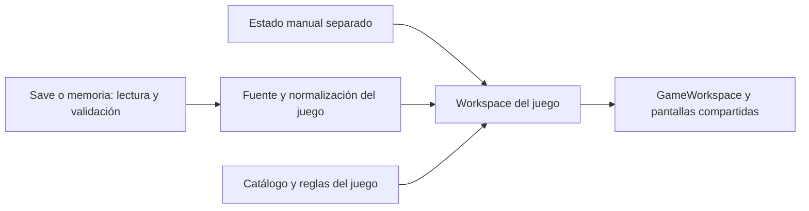

# Contratos para adaptadores de juego

Estado del código: 14 de noviembre de 2026. [English](../adapter-contracts.md) · [Inicio de un adaptador](new-game-adapter.md) · [Índice](README.md).

Esta es la referencia de integración vigente. Los tipos enlazados son la autoridad para las firmas exactas; no hay una interfaz única que obligue a implementar todos los sistemas. Un juego empieza con composición manual y añade fuentes y pantallas opcionales cuando dispone de datos fiables. No copies el workspace de Black ni el protocolo de Citra completo para habilitar una pantalla.

## Límites de responsabilidad



- **Adaptador de juego:** especies, formas, generación, reglas, versión, mapas, inventario y recursos correctos para esa edición.
- **Fuente:** cómo se obtiene una lectura; Manual, Save y Live no son juegos diferentes.
- **Composición:** el workspace elige servicios, traduce estados y conecta capacidades con las pantallas.
- **Dominio/presentación compartidos:** trabajan con identificadores y datos normalizados; no seleccionan ejecutables, direcciones de memoria ni endpoints de un juego.

## Lo obligatorio para montar GameWorkspace

La lista real está en [GameWorkspace.tsx](../../src/games/core/GameWorkspace.tsx). `captureSource` es opcional: omitirlo habilita la edición manual.

| Propiedad | Contrato | Debe aportar el adaptador inicial |
| --- | --- | --- |
| `game` | [GameProfile](../../src/games/profiles.ts) | ID registrado, generación, región traducible, símbolo y todos los módulos declarados. |
| `catalog` | [CatalogService / CatalogRules](../../src/games/core/catalog.ts) | `list(signal?)`, `get(entry, signal?)`, límites, Pokédex regional y recursos de la generación. |
| `storage` | [ManualCollectionStorage](../../src/games/core/manual-storage.ts) | `load()` y `save(state): boolean`; clave propia. Puede usar `createManualStorage(rules)`. |
| `typeRules` | [TypeRules](../../src/domain/type-analysis.ts) | `generation`, `types`, `chart`; usar una tabla existente solo si sus reglas coinciden. |
| `knowledge` | [KnowledgeService](../../src/games/core/knowledge.ts) | `rules`, `stats`, `moves`, `evolution`, con datos filtrados para el juego. |
| `fieldMoveService` | [FieldMoveService](../../src/domain/field-moves.ts) | `id`, `moves`, `resource(pokemon)`, `load(resource)`; compatibilidad propia de la edición. |
| `onChangeGame` | Callback de navegación | Volver al selector; no representa un comando al emulador. |

`knowledge.evolution` sirve a la ficha de una especie y es obligatorio. La pantalla global **Evoluciones pendientes** usa otro servicio opcional. `FieldMoveService` sigue siendo una prop obligatoria aunque un juego no tenga movimientos de campo: en ese caso declara honestamente `moves: []` y un cargador que confirme esa lista vacía, sin copiar MT/MO de otro juego.

### Catálogo e identidad

`SpeciesEntry` contiene `id`, `name` técnico estable y metadatos opcionales (`resourceName`, `form`, `formLabelKey`, `types`). `ManualPokemon` añade tipos y sprite; género y distribución son opcionales. La ausencia de sprite es `null`. La especie nacional, la variedad del recurso y la identidad de un ejemplar son conceptos distintos.

`CatalogRules` incluye `id`, `generation`, `maxSpecies`, `introducedFrom`, `regionalSpeciesIds?`, `types`, `spriteGeneration` y `spriteVersion`. No deduzcas pertenencia regional por intervalo: Kalos contiene especies de generaciones anteriores. La Pokédex regional tampoco implica capturabilidad local.

`createCatalogService` es una implementación útil, no un requisito. Su validador manual actual acepta uno o dos tipos del juego y sprites `null` o URLs bajo el repositorio de sprites de PokéAPI. Un adaptador con recursos locales u otro formato debe ampliar esa validación con pruebas antes de persistirlos; no desactives la comprobación. El equipo manual actual contiene hasta seis especies únicas, no ejemplares duplicados ni formas independientes por especie.

### Conocimiento y movimientos

`KnowledgeRules` declara `gameId`, `generation`, `versionGroup`, `versionGroupId`, `maxSpecies`, `region` y `types`. Las estadísticas, potencia de movimientos, métodos evolutivos y disponibilidad de formas deben corresponder a ese marco histórico, no a los valores modernos por defecto.

`stats(entry, signal?)` devuelve `BaseStats`. `moves(entry, locale, signal?)` devuelve movimientos normalizados. `evolution(entry, locale, signal?)` devuelve árbol y etiquetas; puede incluir Pokémon resueltos. `progression` y `methodFacts` son extensiones opcionales. Un error debe poder mostrarse como error: no lo conviertas en una familia vacía confirmada.

En `FieldMoveService`, `resource` distingue las formas que cambian compatibilidad y `load` devuelve solo movimientos admitidos por `moves`. La compatibilidad no significa que el Pokémon conozca el movimiento ni que el jugador tenga su MT/MO. Los IDs admitidos hoy están en `FIELD_MOVE_IDS`; añadir uno nuevo exige ampliar ese límite y su presentación bilingüe.

### Animaciones opcionales

`CatalogService.animation(pokemon)` y `SavedRosterService.animation(pokemon)` son opcionales y devuelven URL o `null`. Los consume el equipo ampliado; no requieren animar catálogo, colección ni modo compacto. La animación se resuelve en el adaptador, por variedad: Black usa `animatedBlackWhiteSprite`, X/Y `animatedBattleSprite`. No uses el helper 3D para Black. Los componentes conservan respaldo estático, movimiento reducido y pausa del sprite de un ejemplar debilitado. El gris de la textura es presentación del estado confirmado de PS, no una modificación del tipo.

## Datos sincronizados: equipo, cajas y Pokédex

| Contrato | Obligatorio al habilitar | Semántica y consumidor |
| --- | --- | --- |
| [SavedPokemonData / SavedPartyMember / SavedBoxPokemon](../../src/models/party.ts) | Lectura de ejemplares | Identidad, especie, forma y campos validados según el juego. PS actuales solo donde existen; no inventarlos para cajas. |
| [SavedRosterService](../../src/games/core/saved-roster.ts) | Equipo o colección sincronizados | `resolve(member, signal?)`, `describe(member, locale, signal?)`; `animation` y `hatching` opcionales. |
| `SavedRosterPokemon` | Resultado normalizado | Conserva personalidad, entrenador, posición, ubicación, apodo e identidad de instancia; no deduplicar por especie. |
| [PokedexState](../../src/models/pokedex.ts) | Descubrimiento/capturas desde partida | Conjuntos independientes de vistas y capturadas; serializar para transporte y restaurar conjuntos en frontend. |
| [SavePokedexReader](../../src/games/core/save-pokedex.ts) | Lector de save que adopte ese contrato | `byteLength`, `parse(bytes)`; `parsePokemon`, `parseInventory` y `parseDaycare` opcionales. |

`resolveSavedRoster` mantiene duplicados y orden; reutiliza resolución de especie/forma para ahorrar trabajo. El crecimiento y las estadísticas complementarias no deben inventar PS actuales. `hatching.stepsPerCycle` debe proceder de las reglas del juego y requiere ciclos confirmados; un huevo no participa en el análisis.

No hay una interfaz universal de sesión. Actualmente existen rutas distintas: `PokemonDataSource`/`PokemonSnapshot` para la integración histórica de Black; `PokedexBridgeSnapshot` + `createPokedexSource` para Save X/Y; `LivePartySnapshot` + `createLivePartySource` para Live X/Y. Consulta [fuentes](data-sources.md). Estas últimas siguen acopladas a IDs X/Y y límites Gen VI; no se pueden copiar a una generación nueva cambiando una cadena. Amplía validación y protocolo explícitamente o crea la frontera de fuente adecuada.

### Composición de captureSource

El tipo está **en línea en las props de GameWorkspace**, no en una interfaz exportada llamada `CaptureSource`. Para reutilizarlo sin duplicar firmas:

```ts
import type { ComponentProps } from 'react'
import { GameWorkspace } from '../../src/games/core/GameWorkspace'

type WorkspaceSource = NonNullable<ComponentProps<typeof GameWorkspace>['captureSource']>
```

Al aportarlo se requieren `mode`, `pokedex`, `controls`, `stale` y `saveFailed`. Se pueden añadir `roster`, `capabilities`, `inventory`, `location`, `collectionControls`, `collectionStale` y `battlePanel`. Las capacidades de esta prop son `{ party, boxes, pokedex }`; no son el mismo tipo que las capacidades del protocolo Live.

`roster` incluye equipo resuelto (`party`), colección (`collection`), carga, actualización, error, reintento, servicio y `boxCount`. El número de cajas viene del adaptador: Black 24; X/Y 31. `battlePanel(callback)` monta la pantalla de combate e informa la conexión para navegación automática. No introduzcas fetches del puente en esa pantalla compartida.

## Lecturas desconocidas, vacías y antiguas

| Valor | Significado que debe conservarse |
| --- | --- |
| `null`, campo opcional omitido o `state: 'unknown'` | Dato no disponible o no confirmado, según el contrato específico. |
| `[]`, `{}` o mapa vacío tras lectura válida | Ausencia confirmada, no error. |
| `stale: true` / `collectionStale: true` | Dato retenido; puede mostrarse con aviso, no como nueva confirmación. |
| `status: 'ready'` | Estado del lector; no sustituye comprobar actividad, campos y vigencia. |
| `activity: 'inactive'` | Salida confirmada de combate; no equivale a una interrupción. |

Una colección parcial sin cajas no se presenta como colección completa. No mezcles bolsa de una lectura con equipados de otra. No atribuyas el último dato de X a Y al cambiar de fuente/juego. `seen` puede descubrir una imagen; solo `caught` marca una captura histórica. Poseer ahora una especie no reemplaza ninguna de esas banderas.

## Pantallas y extensiones opcionales

Omitir un servicio es la forma de no implementar una función. No aportes un servicio vacío para anunciar soporte. Las funciones siguientes no son necesarias para el primer montaje manual.

| Prop de GameWorkspace | Contrato y operaciones | Condición de integración |
| --- | --- | --- |
| `encounters` | [EncounterAtlasData / EncounterAtlasService](../../src/games/core/encounters.ts), datos o `load(signal?)` | Zonas ordenadas, subzonas, métodos, niveles, probabilidades y condiciones propios. `initialZoneId` debe existir. `browseEncountersInManual` permite consulta manual. |
| `acquisition` | [AcquisitionService](../../src/games/core/acquisition.ts): instrucciones, rutas, detalles; disponibilidad opcional | Diferenciar obtención independiente, intercambio, evento, externa y desconocida. Exclusivo exige disponibilidad propia confirmada y ausencia confirmada en la contraparte. |
| `evolutionRequirements` | [EvolutionRequirementsService](../../src/games/core/evolution-requirements.ts): ámbitos, familia, objeto y hechos | Filtrar familias/métodos antes de llegar a la UI. `inventoryKey` opaca enlaza con `EvolutionInventory`. |
| `captureSource.inventory` | `EvolutionInventory` (compatible estructuralmente con `MegaInventory`) | `quantities: null` desconocido; mapa vacío confirmado; `stale` obligatorio. Bolsa/equipados del mismo snapshot. |
| `zoneItems` | [ZoneItemsService](../../src/games/core/zone-items.ts): `id`, `load(zoneId, locale, signal?)`, `find(itemId, locale, signal?)` | Mismos IDs de ocurrencia en ambas consultas; cobertura `documented` o `unrecorded`; fuentes y notas de idioma explícitas. Necesita el atlas para mostrar la pestaña de objetos. |
| `megaEvolutions` | [MegaEvolutionService](../../src/games/core/mega-evolutions.ts): `load(locale, signal?)` | Solo formas/piedras compatibles con el juego; estadísticas históricas base/mega, tipos e IDs de inventario coherentes. No hay flag `mega` en `GameModule`: se habilita por servicio. |
| `daycare` | [DaycareService / DaycareReading](../../src/games/core/daycare.ts) | `resolve`, `experienceLevels`, `evolutionLevel`; lectura con disponibilidad, vigencia, dos espacios y huevo. El validador actual supone dos espacios; otros sistemas requieren extensión concreta. |
| `album` | [AlbumService](../../src/games/core/album.ts) | Lista regional, edición, región, `get`, descripción y `animation` (puede devolver `null`). Las animaciones deben pertenecer al juego. |
| `captureSource.location` | [CaptureLocationReading](../../src/models/capture-location.ts) | `scope`, `available`, `zoneId`, `stale`; mapear el ID del emulador a zona del atlas antes de presentarlo. |
| `connectionStatus` | [ConnectionStatus / ConnectionActions](../../src/models/connection-status.ts) | Lectores reales, estado y fechas; textos localizados por composición. Una petición HTTP aceptada no confirma lectura válida. |
| `preferences`, `notifications`, `catalogSpeciesGender` | Props de composición | Preferencias con persistencia booleana, avisos propios y política visual de género. No cambian las reglas del juego. |

Repelente es una composición específica de Black mediante `notifications`; X/Y lo declaran fuera de implementación en `unplannedModules`. No conviertas esas excepciones en obligaciones para juegos nuevos. Megas y objetos por zona tampoco son requisitos de todos los juegos.

## Combate

Los tipos de [combat.ts](../../src/games/core/combat.ts), [combat-capabilities.ts](../../src/games/core/combat-capabilities.ts), [combat-presentation.ts](../../src/games/core/combat-presentation.ts) y [models/combat.ts](../../src/models/combat.ts) se usan **solo si se implementa combate**.

- `CombatService.resolve(speciesId, form, signal?)` devuelve nombre, tipos, sprite y animación opcional. Objeto equipado y apertura de estadísticas son extensiones opcionales.
- `CombatReading` es la ruta individual histórica; `FieldCombatReading` es la ruta del campo, con actividad independiente de conexión.
- `CombatField` tiene formato confirmado/desconocido y dos bandos. `single` reserva 1/1 puestos; `double` 2/2; `horde` 1/5. No derives el formato del número de supervivientes.
- Cada puesto es ocupado, vacío o desconocido. Cada ocupante referencia un `ownerId`; propietarios jugador/aliado/rival/salvaje son distintos. Un aliado de historia no entra al equipo del jugador. `partySlot` pertenece al equipo de ese propietario.
- `rosterTotal` es el total inicial del bando, no sus supervivientes. Puede superar seis con varios propietarios, sin revelar las especies de reservas.
- `GameCombatCapabilities` declara existencia en el juego; `CombatReaderCapabilities` declara implementación validada del lector. `readable` no significa conectado.
- Un formato `special` usa `gameId` e ID; la presentación opcional no concede soporte de lectura. No se han implementado lectores/renderizadores de triples o rotatorios.
- `validCombatField` comprueba coherencia normalizada. El adaptador debe validar entrada no confiable, límites, identidad, formas y edición. Los fallos parciales conservan la sesión; un combate terminado la cierra.

Black conserva la lectura individual. X/Y implementan sencillos, dobles, hordas y dobles con aliado para sus perfiles locales. Véanse [guía de combate](multi-battle.md) y [aliados](partner-battles.md). La presentación se comparte; no copies CSS de combate a una carpeta de juego para cubrir una resolución.

## Idioma, persistencia y fallos

- Los IDs de especie, forma, objeto, método, zona y ocurrencia no se traducen. Usa claves de presentación y recursos ES/EN reflejados; los servicios que reciben `locale` deben respetarlo.
- Caché traducida: clave por juego y locale. Caché de datos crudos multilingües puede no necesitar locale; documenta esa decisión.
- `AbortSignal` debe cancelar trabajo y evitar publicaciones después del desmontaje. Las fuentes deben devolver cleanup y mantener instancias estables.
- Mensajes de puente: códigos estables permitidos por validador y mapeados en `src/i18n/bridge-messages.ts`; añadir claves ES/EN y reiniciar el servicio al cambiar protocolo.
- `persistValue` puede desalojar cachés desechables para reintentar una escritura; no garantiza almacenamiento ilimitado. Un `false` debe llegar al aviso de la UI. Estado manual, checklist y caché no son intercambiables.

## Límites actuales que un nuevo adaptador debe conocer

`GameId` es una unión cerrada (Black/X/Y), no un registro dinámico. El equipo manual usa hasta seis especies únicas. Las validaciones de guardería y algunos modelos de transporte tienen supuestos de forma/rango concretos. La implementación Live X/Y importa límites y datos alojados en X; la reutilización XY es intencional, no un protocolo universal. Black mantiene proveedores históricos detrás de sus adaptadores. Documenta una excepción material y extrae solo la frontera necesaria; no anuncies soporte ampliando un número sin probar su normalización.

## Criterio de entrega

Pruebas de reglas/normalización propias, diferencias frente a adaptadores existentes, aislamiento de claves, valores desconocidos/vacíos/antiguos, cancelación y capacidades. Pruebas con fixtures sintéticos para formatos y recuperación; jamás mutar la partida real. `npm test`, `npm run lint`, `npm run build`. Revisión visual en anchos intermedios, móvil y escritorio, incluyendo claro/oscuro y los servicios opcionales que se habiliten. Registrar qué se comprobó con datos sintéticos y qué con emulador real.
